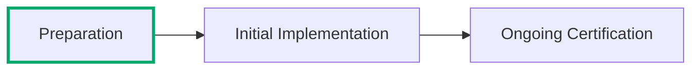

---
tags:
  - Cloud Service Providers
  - Guidance
picto:
  source: person
---

# Choosing a Certification Path

There are two FedRAMP Certification Paths:

- **Program Certification** is provided directly by FedRAMP and does not require a federal agency to "sponsor" the service for FedRAMP Certification; this path is mostly only available for the 20x Certification Type.
- **Agency Certification** requires a federal agency to authorize the service in advance, following the legacy FedRAMP process, then "sponsor" the service for FedRAMP Certification; this path is only available for the Rev5 Certification Type.

## Choice is a Misnomer

You don't really get to choose your Certification Path because it's the result of the choices you've already made.

- If you intend to obtain a FedRAMP 20x Certification, then you will automatically proceed on the Program Certification Path.
- If you already have an agency sponsor for FedRAMP Rev5, then you will likely proceed on the Agency Certification Path.
- In very limited circumstances, the Program Certification Path is open FedRAMP Rev5 based on specific criteria.

!!! tip "You may obtain a FedRAMP 20x Class A Certification then change it to FedRAMP Rev5 Class B, C, or D via Agency Certification."

### FedRAMP 20x Profiles

| Type | Class | Program Certification Path | Agency Certification Path|
| -- | -- | -- | -- |
| **20x** | Class A | :lucide-badge-check:{ .xl .middle .stable } Required | :lucide-circle-slash:{ .xl .middle .empty } Unavailable|
| **20x** | Class B |  :lucide-badge-check:{ .xl .middle .stable } Required | :lucide-circle-slash:{ .xl .middle .empty } Unavailable|
| **20x** | Class C |  :lucide-badge-check:{ .xl .middle .stable } Required | :lucide-circle-slash:{ .xl .middle .empty } Unavailable|
| **20x** | Class D |  :lucide-wrench:{ .xl .middle .placeholder } Coming In 2027 | :lucide-circle-slash:{ .xl .middle .empty } Unavailable|

### FedRAMP Rev5 (Legacy) Profiles

| Type | Class | Program Certification Path | Agency Certification Path|
| -- | -- | -- | -- |
| _Rev5_ | Class A | :lucide-circle-slash:{ .xl .middle .empty } Unavailable | :lucide-circle-slash:{ .xl .middle .empty } Unavailable|
| _Rev5_ | Class B | :lucide-circle-dashed:{ .xl .middle .placeholder } Limited| :lucide-badge-check:{ .xl .middle .stable } Generally Required|
| _Rev5_ | Class C | :lucide-circle-dashed:{ .xl .middle .placeholder } Limited| :lucide-badge-check:{ .xl .middle .stable } Generally Required|
| _Rev5_ | Class D | :lucide-circle-slash:{ .xl .middle .empty } Unavailable | :lucide-badge-check:{ .xl .middle .stable } Required|

## Limited Program Certification for Rev5

FedRAMP is making Program Certification available for Rev5 in extremely limited circumstances in the FedRAMP 20x Phase 4 Rev5 Program Closeout initiative. This initiative is intended to provide a Rev5 option for a very limited subset of cloud services who have heavily invested into FedRAMP Rev5 but were unable to complete their Agency Certification due to circumstances outside their control.

This initiative includes strict eligibility requirements, mandatory full CR26 adoption, and a case-by-case application and review. Cloud services must be able to demonstrate that their service is intended to be used by federal agencies directly or inside cloud services used by federal agencies directly.

More information about the Rev5 Program Closeout initiative, including deadlines and eligibility criteria, are available on the [FedRAMP 20x Phase 4 micro-site](https://www.fedramp.gov/20x/phase4).
